<div align="center">

# Kairo

**Role-aware, multi-tenant operations for associations.**

Membership · Finance · Governance · Discipline · Documents · Notifications · optional private AI

[Live demo →](https://kairo.patrickdjimgou.dev/demo) &nbsp;·&nbsp;
[Architecture](#architecture) &nbsp;·&nbsp;
[API & interfaces](#api-and-interfaces) &nbsp;·&nbsp;
[Screenshots](#screenshots) &nbsp;·&nbsp;
[Quick start](#quick-start) &nbsp;·&nbsp;
[Documentation](#documentation)

<br />

[](https://github.com/VirgileDjimgou/Kairo/actions/workflows/ci.yml)


[](LICENSE)

</div>

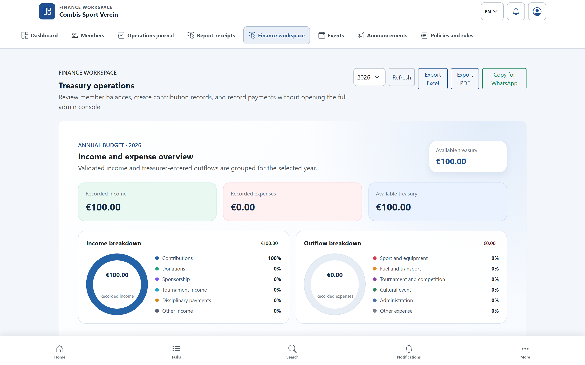

---

## Why Kairo

Community organisations run on a few elected volunteers who each need a different view
of the same data: the treasurer validates money, the secretary keeps records, the
president oversees, and members want to know where they stand.

Kairo gives every role a focused workspace in one multilingual (FR/EN/DE), multi-tenant
platform. Authorisation, tenant isolation and money decisions are enforced by the backend,
never by the client.

- **Backend-owned policy** — FastAPI is the only enforcement point; the client only shapes presentation.
- **Tenant isolation by default** — every tenant-scoped query carries `tenant_id`.
- **Auditable money** — contributions, receipt custody, expenses, budgets, exports and an operations journal.
- **Installable PWA** — responsive phone layouts, offline shell, Web Push and notification deep links.
- **Optional private AI** — local Ollama/Qdrant behind a signed gateway; the core platform runs without it.

### Core workflows

- **Member onboarding:** create a profile, generate the member code, optionally issue first-login access, then manage the lifecycle.
- **Cash receipt:** an authorised officer declares a received payment; the treasurer validates it, follows cash handover and confirms treasury custody.
- **Treasury:** record contributions, payments and categorised expenses; review the annual budget and export Excel, PDF or a WhatsApp-ready summary.
- **Governance:** publish documents, policies, events and announcements; keep disciplinary records behind explicit read/write boundaries.
- **Notifications:** producers submit canonical intents; the authenticated inbox is the source of truth and Web Push/FCM carry generic delivery hints.

## Screenshots

All captures use the **English interface** against the seeded demo tenant, at desktop
(1440×900) and phone (390×844) widths. UI labels are English; tenant content (names,
document titles, records) is the multilingual demo dataset. Captures authenticate through
the real FastAPI contract; no permission is simulated in the client.

| Member portal | Contribution statement |
| --- | --- |
| 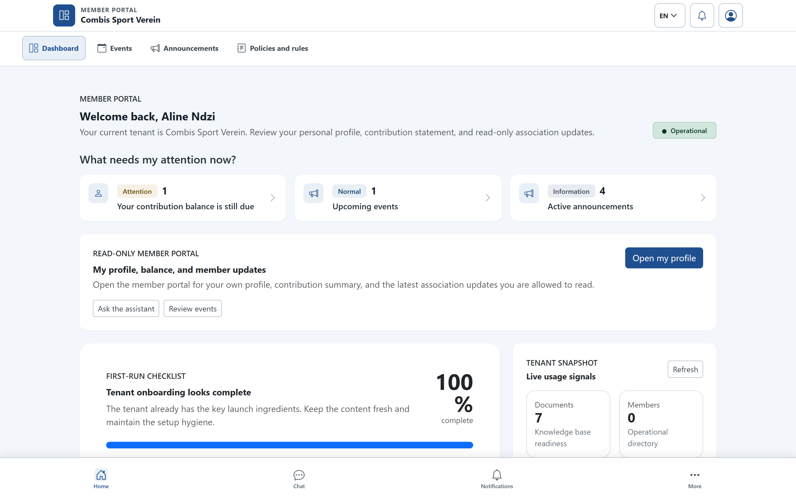 | 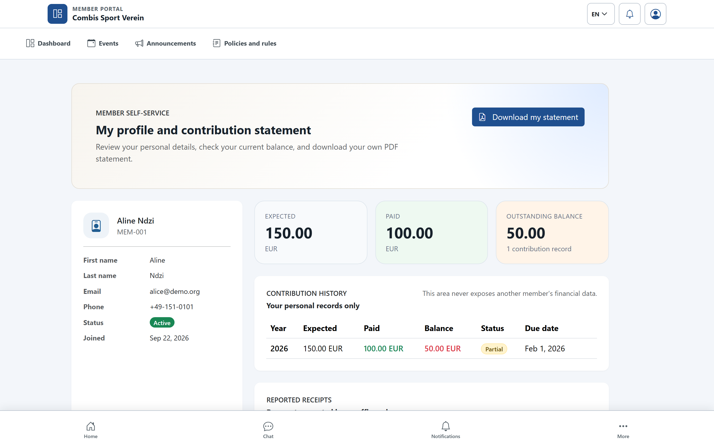 |
| **Member administration** | **Receipt declaration** |
| 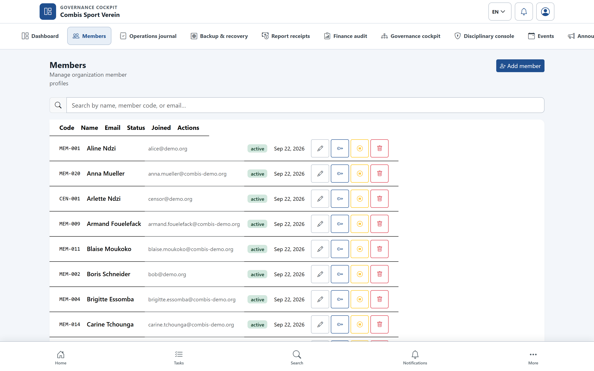 | 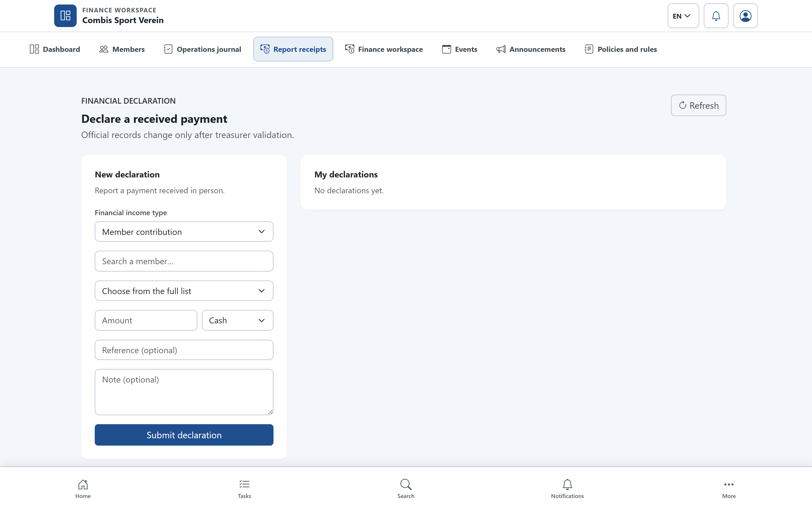 |
| **Governance cockpit** | **Disciplinary console** |
| 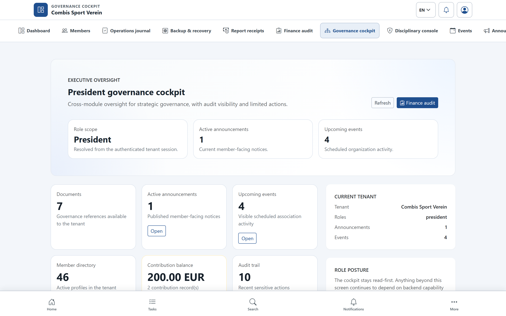 | 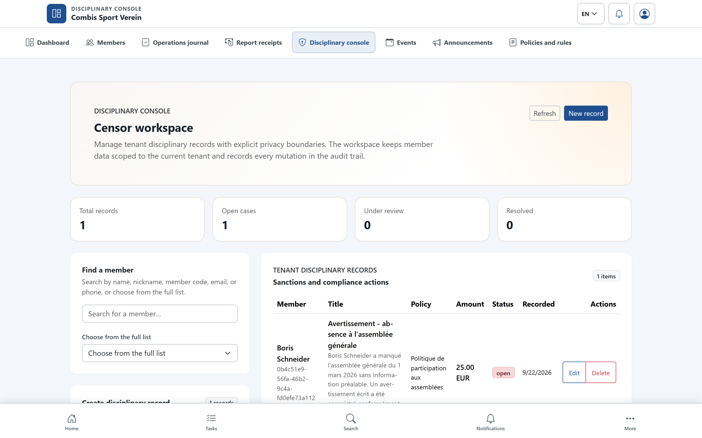 |
| **Secretary workspace** | **Operational health** |
| 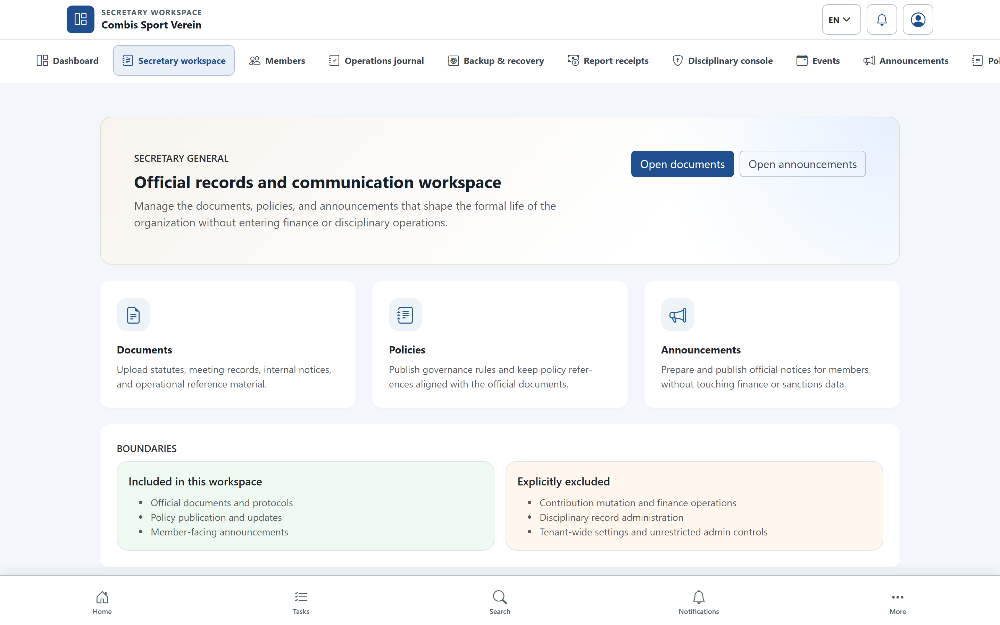 | 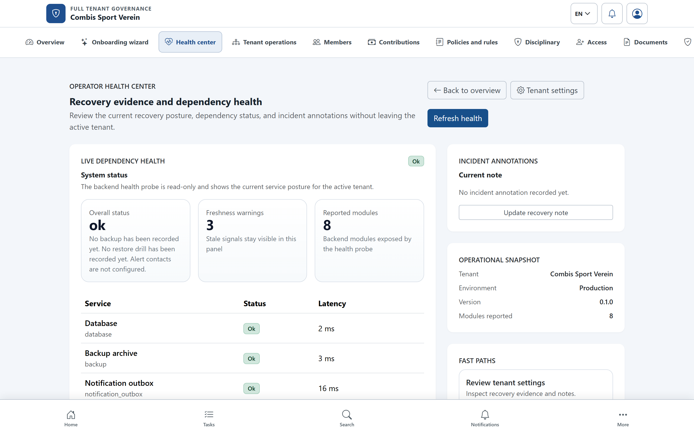 |

**Mobile & PWA**

| Member dashboard | Treasury workspace | Governance cockpit |
| --- | --- | --- |
| 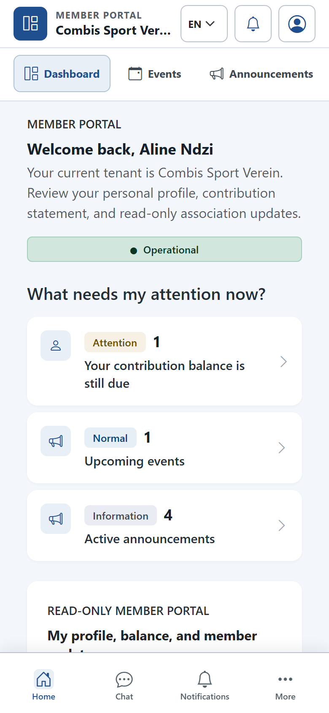 | 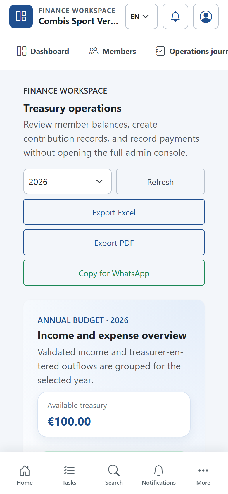 | 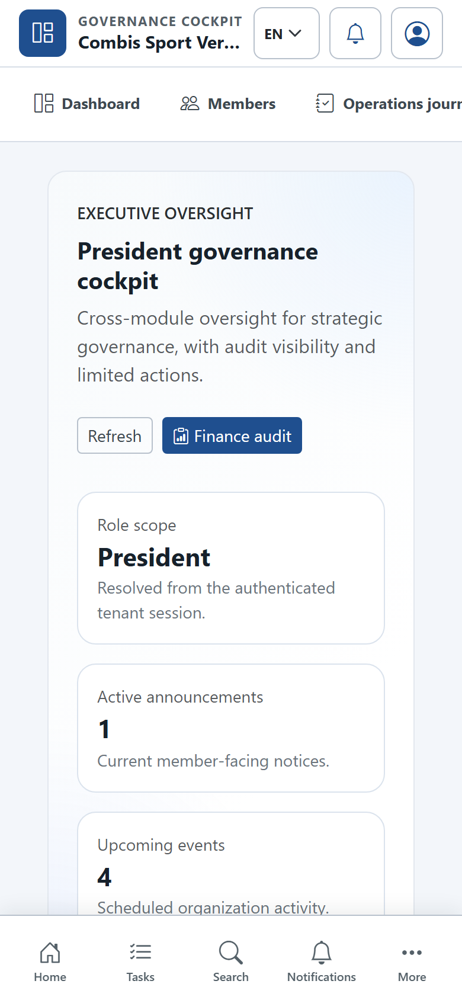 |

The full gallery (sign-in, demo entry, announcements, notifications, administration and
tenant operations) is reproducible with `node scripts/capture-readme-screenshots.mjs`.
Pass `KAIRO_SCREENSHOT_ACCOUNTS` for an instance with rotated demo credentials and
`KAIRO_SCREENSHOT_BASE_URL` to target another deployment. The source manifest is
[`docs/screenshots/MANIFEST.md`](docs/screenshots/MANIFEST.md).

## Architecture

Kairo is a **modular monolith**: one FastAPI application, one PostgreSQL database and one
Celery worker. Routers stay thin, services orchestrate, and repositories isolate
persistence. There are no microservices.

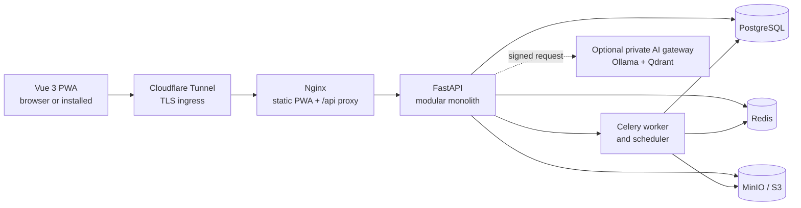

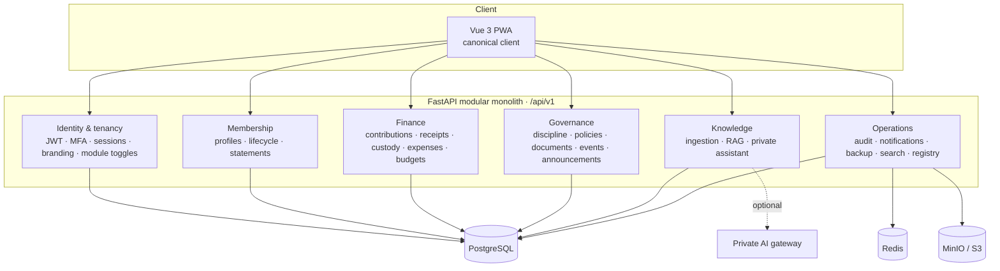

### Boundaries

- **Backend owns authorisation.** Roles are capability bundles; `GET /auth/me` exposes effective capabilities, but each endpoint still checks the required capability.
- **Tenant scope is mandatory.** Services and repositories filter by `tenant_id`; cross-tenant reads are treated as security defects.
- **Modules compose through the internal registry.** Each module ships a `module.py` descriptor; tenant toggles, navigation, search providers and AI context providers are composed from it. `GET /api/v1/modules` returns tenant/capability-filtered metadata.
- **RAG filtering happens before prompt assembly.** Retrieved chunks are filtered by tenant and access scope; unauthorised chunks never reach the model and the LLM never decides access.
- **Notifications are delivery hints.** The authenticated, tenant-scoped inbox is authoritative. Push payloads stay generic and deep links are allowlisted and revalidated by the PWA.
- **OpenAPI is the client contract.** `docs/api/openapi.json` is versioned; generated TypeScript contracts are drift-checked in CI.

### Deployment modes

| Mode | Composition | Use |
| --- | --- | --- |
| Local development | `docker-compose.yml` | Full stack with hot reload and optional AI services |
| Core only | `docker-compose.core.yml` | Web, API, PostgreSQL, Redis, MinIO and workers; no AI runtime |
| Core + private AI | Core + `docker-compose.ai-local.yml` | Ollama/Qdrant stay on a controlled machine behind a signed gateway |
| Production edge | Cloudflare Tunnel → Nginx | No application port published on the host; private services stay on the Docker network |

## Modules

| Module | Responsibility |
| --- | --- |
| **Identity & tenancy** | Authentication, MFA, sessions, invitations, access recovery, tenant switching, roles, branding, module toggles and tenant-aware PWA manifests |
| **Membership** | Member directory, profiles, lifecycle controls, structured addresses, statements, imports and exports |
| **Finance** | Contributions, payments, receipt declarations, treasurer validation, custody handover, expenses, annual budgets, reminders and exports |
| **Governance** | Policies, documents, events, announcements and confidential disciplinary records |
| **Knowledge & assistant** | Document ingestion, retrieval-augmented chat, citations, refusal behaviour and authorised domain context |
| **Operations** | Audit journal, notification inbox/outbox, push providers, encrypted backups, recovery centre, global search and module registry |

## API and interfaces

All business endpoints live under `/api/v1`. Interactive API documentation is available
at `/docs` when `APP_DEBUG=true`; the committed schema is
[`docs/api/openapi.json`](docs/api/openapi.json).

| Surface | Main routes | Purpose |
| --- | --- | --- |
| Authentication | `/api/v1/auth/*` | Login, MFA, sessions, invitations, password recovery, tenant switch, `/me` capabilities |
| Tenants | `/api/v1/tenants/*` | Tenant settings, role bundles, branding, public manifest and host resolution |
| Members | `/api/v1/memberships/*` | Directory, profiles, lifecycle, personal statements, imports and exports |
| Finance | `/api/v1/contributions/*` | Contributions, payments, receipts, custody, expenses, budgets, reminders and reports |
| Governance | `/api/v1/policies`, `/documents`, `/events`, `/announcements` | Content publication and role/module-scoped visibility |
| Discipline | `/api/v1/disciplinary/*` | Confidential records and sanctions with explicit read/write boundaries |
| Notifications | `/api/v1/notifications/*` | Inbox, preferences, devices, Web Push/FCM registration, deep links and pipeline health |
| Assistant | `/api/v1/chat/*` | Domain policy, conversations, streamed answers and citations |
| Operations | `/api/v1/admin/audit`, `/recovery`, `/modules`, `/search`, `/attention` | Operations journal, backups, registry metadata, global search and attention queues |
| System | `/health`, `/health/live`, `/health/ready`, `/metrics` | Dependency health, readiness probes and privacy-safe runtime metrics |

**Client boundary.** The Vue PWA consumes only typed API gateways. Generated contract
types come from the committed OpenAPI schema; no client code makes an authorisation
decision. One canonical Service Worker owns install/offline behaviour, update detection,
Web Push, Firebase background messages and notification-click routing.

**External interfaces.** Web Push (VAPID), Firebase Cloud Messaging, MinIO/S3 object
storage, SMTP and optional Telegram/WhatsApp operator channels. The optional AI gateway
validates a signed, short-lived server request; Ollama and Qdrant are never exposed to the
browser.

```bash
# Probe the API
curl -s http://localhost:8000/health

# Authenticate against the local seed and call a protected route
TOKEN=$(curl -s -X POST http://localhost:8000/api/v1/auth/login \
  -H "Content-Type: application/json" \
  -d '{"email":"president@demo.org","password":"President123!","tenant_slug":"demo"}' \
  | jq -r .access_token)
curl -s -H "Authorization: Bearer $TOKEN" http://localhost:8000/api/v1/auth/me
```

## Security model

- Authorisation is enforced in the backend; roles are capability bundles and the client only hides what the API already forbids.
- Every tenant-scoped query includes `tenant_id`; tenant module toggles remove whole features from every client.
- Role actions, finance decisions and recovery operations are audit logged.
- Push payloads never carry finance or disciplinary detail; unsafe or unknown deep links fall back to the authenticated inbox.
- Backups are encrypted, signed and SHA-256 verified; restore drills run in isolation.
- Secrets live in ignored environment files; CI runs a sensitive-file scanner and a gitleaks history scan.

## Roles

| Role | Primary focus |
| --- | --- |
| President | Executive overview, member administration, finance and governance visibility |
| Vice president | Delegated oversight, member visibility and receipt declaration |
| Secretary general | Member administration, documents, policies, announcements and read-only discipline visibility |
| Treasurer | Financial records, receipt validation, custody follow-up, expenses and exports |
| Auditor | Read-only financial oversight and exports |
| Censor | Confidential disciplinary records and sanction management |
| Sports manager | Sports events and programme coordination |
| Ordinary member | Personal profile, contribution status, permitted documents, events and announcements |
| Principal admin | Operational maintenance, tenant configuration, health and recovery |

## Tech stack

| Layer | Technology |
| --- | --- |
| Web client | Vue 3, TypeScript, Pinia, Vue Router, Vite, Bootstrap, PWA Service Worker |
| API | Python 3.12, FastAPI, SQLAlchemy, Pydantic, Alembic |
| Data & jobs | PostgreSQL, Redis, Celery worker and scheduler |
| Object storage | MinIO / S3-compatible |
| Private AI (optional) | Signed AI gateway, Ollama, Qdrant |
| Delivery | Docker Compose, Nginx, Cloudflare Tunnel |
| Quality | pytest, ruff, mypy, vue-tsc, Playwright, gitleaks, GitHub Actions |

## Quick start

Prerequisites: Docker Desktop, Docker Compose and Git.

```powershell
git clone https://github.com/VirgileDjimgou/Kairo.git kairo
Set-Location kairo
Copy-Item .env.example .env
docker compose up --build
```

Seed the local demo data in a second terminal:

```powershell
docker compose exec api python -m app.db.seed
```

Then open:

- Web client: [http://localhost:5173](http://localhost:5173)
- API documentation: [http://localhost:8000/docs](http://localhost:8000/docs)

**Core deployment without AI:**

```powershell
Copy-Item .env.core.example .env.core
docker compose --env-file .env.core -f docker-compose.core.yml up -d --build
```

**Optional private AI runtime:**

```powershell
Copy-Item .env.ai-local.example .env.ai-local
docker compose --env-file .env.ai-local -f docker-compose.ai-local.yml --profile ai-tunnel up -d --build
```

When the local AI runtime is unavailable, the core platform remains available and the
client reports the AI state clearly. Production deployment and rollback procedures are in
the [deployment runbook](docs/operations/deployment-runbook.md) and the
[Hetzner portfolio runbook](docs/operations/hetzner-portfolio-runbook.md).

## Project layout

```text
kairo/
├── apps/web/                 Vue 3 PWA (canonical client)
├── services/api/             FastAPI modular monolith, Celery worker and tests
├── docs/                     Architecture, API, operations, PWA and validation guides
├── scripts/                  Deployment, recovery, contract and screenshot helpers
├── seed/                     Local demonstration data
├── constitution/             Product and security principles
└── docker-compose*.yml       Local, core, production and optional-AI stacks
```

## Quality checks

```powershell
# Backend
python -m pytest services/api/tests -q
python -m ruff check services/api/app/ services/api/tests/
python -m mypy --config-file services/api/pyproject.toml --explicit-package-bases services/api/app/

# Web
Set-Location apps/web
npm ci
npm run type-check
npm run build
npm run test:e2e:locale
npm run test:e2e:roles
npm run test:e2e:release-candidate
npm run test:e2e:a11y
Set-Location ../..

# Contracts, PWA guard, performance and repository guards
npm run contracts:check
npm run pwa:check
npm run perf:check
node scripts/check-sensitive-files.mjs
node scripts/check-i18n-parity.mjs
node scripts/check-i18n-coverage.mjs
```

The maintained command list and responsive checks are in
[`docs/operations/validation-baseline.md`](docs/operations/validation-baseline.md).

## Status and roadmap

Kairo is an active portfolio project. The Vue 3 PWA is the canonical, supported client.
The Flutter source under `apps/flutter_kairo/` is frozen legacy/reference code (ADR-014):
it consumes the same API contracts but receives no new business features and is not part
of the release pipeline.

Roadmap V2 covers Sprints 100–130 — PWA-first consolidation, notification reliability,
white-label tenant branding, tenant domains and the full-stack release gate. Current
sprint state and evidence live in the
[Roadmap V2 JSON](docs/roadmap/KAIRO_V2_ROADMAP.json),
[`PROJECT_STATUS.md`](PROJECT_STATUS.md) and the
[release-candidate evidence](docs/sprint-118-release-candidate-evidence.md).

## Documentation

- [Current architecture](docs/architecture/CURRENT_ARCHITECTURE.md)
- [Architecture decision records](docs/architecture/decisions/)
- [Deployment guide](docs/deployment-guide.md)
- [Deployment and rollback runbook](docs/operations/deployment-runbook.md)
- [Encrypted recovery runbook](docs/operations/encrypted-recovery-runbook.md)
- [Notification operator guide](docs/notifications/NOTIFICATION_OPERATOR_GUIDE.md)
- [PWA architecture](docs/pwa/PWA_ARCHITECTURE.md)
- [White-label branding](docs/pwa/WHITE_LABEL_BRANDING.md)
- [Validation baseline](docs/operations/validation-baseline.md)
- [Frontend architecture](docs/FRONTEND_ARCHITECTURE.md)
- [Design system](docs/DESIGN_SYSTEM.md)
- [Roadmap V2](docs/roadmap/KAIRO_V2_ROADMAP.md)
- [Contributing](CONTRIBUTING.md)

## License

Kairo is released under the [MIT License](LICENSE).

<div align="center">
<br />
If this project is useful or interesting, a ⭐ on GitHub is appreciated.
</div>
